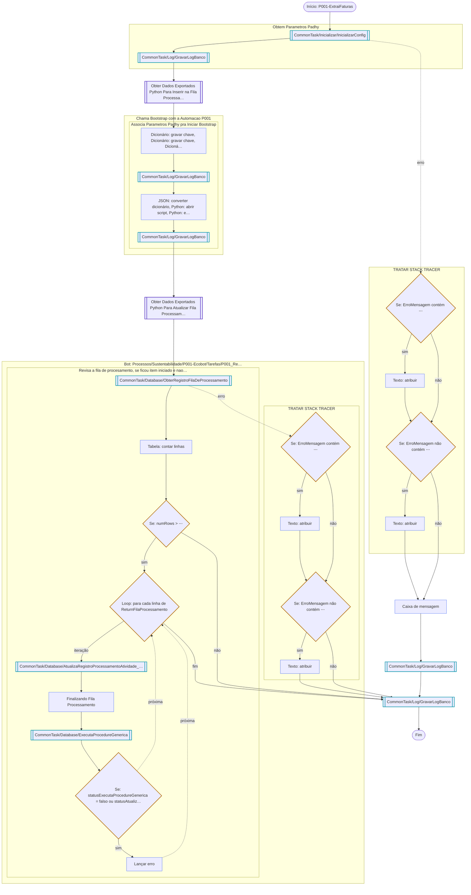

# P001-ExtraiFaturas

| | |
|---|---|
| Caminho no export | `Processos/Sustentabilidade/P001-Ecobot/P001-ExtraiFaturas` |
| Ações | 34 |
| Profundidade de expansão | 3 |

## Passos detalhados

| | Passo | Nós |
|---|---|---|
| 1 | [Obter Dados Exportados Python Para Inserir na Fila Processamento](Subtasks/01-obter-dados-exportados-python-para-inserir-na.md) | 21 |
| 2 | [Faz loop em cada fatura na pasta](Subtasks/02-faz-loop-em-cada-fatura-na-pasta.md) | 22 |
| 3 | [Obter Dados Exportados Python Para Atualizar Fila Processamento](Subtasks/03-obter-dados-exportados-python-para-atualizar.md) | 24 |
| 4 | [Obtem Item Fila Processamento e intera sobre o excel exportado](Subtasks/04-obtem-item-fila-processamento-e-intera-sobre-o.md) | 12 |

## Variáveis

| Nome | Tipo | Entrada | Saída |
|---|---|---|---|
| `InputParametrosPython` | Dictionary | — | — |
| `ReturnPadhy` | Dictionary | — | — |
| `JsonPythonOutput` | String | — | — |
| `statusGestaoAtividade` | Boolean | — | — |
| `ValuesInsertFilaProcessamento` | String | — | — |
| `FilesInFolder` | Dictionary | — | — |
| `IdUser` | String | — | — |
| `NomeArquivo` | String | — | — |
| `MesAno` | String | — | — |
| `TipoFatura` | String | — | — |
| `IdRegistroAtividadeFilaProcessamento` | String | — | — |
| `IdFilaProcessamento` | String | — | — |
| `ReturnFilaProcessamento` | Table | — | — |
| `rowFilaProcessamento` | Record | — | — |
| `ListIdFilaProcessamento` | List | — | — |
| `ErroMensagem` | String | — | — |
| `EncontrouRegistros` | Boolean | — | — |
| `ErroLinha` | Number | — | — |
| `TableExcelExport` | Table | — | — |
| `rowExcelExport` | Record | — | — |
| `rowIndexFilaProcessamento` | Number | — | — |
| `TableAuxiliarFilaProcessamento` | Table | — | — |
| `rowTableAuxiliarFilaProcessamento` | Record | — | — |
| `statusAtualizarAtividade` | Boolean | — | — |
| `Query` | String | — | — |
| `InputsTask` | String | — | — |
| `JsonPythonInput` | String | — | — |
| `returnPython` | Dictionary | — | — |
| `status_execucao` | Number | — | — |

## Chamadas

Nome e tipo dos parâmetros. O valor passado não aparece: numa entrada ele é uma expressão que pode carregar literal (§9).

| Bot | Direção | Parâmetro | Tipo | Variável no chamador |
|---|---|---|---|---|
| `CommonTask/Inicializar/InicializarConfig` | entrada | `BotName` | String | ⋯ |
|  | saída | `Return` | Dictionary | `ReturnPadhy` |
| `CommonTask/Log/GravarLogBanco` | entrada | `NomeBot` | String | `ReturnPadhy` |
|  | entrada | `IdProcesso` | String | `ReturnPadhy` |
|  | entrada | `Mensagem` | String | ⋯ |
|  | entrada | `IdArea` | String | `ReturnPadhy` |
|  | entrada | `TipoLog` | Boolean | ⋯ |
| `CommonTask/Database/ObterIDUsuario` | entrada | `ObterViaEmailHypera` | Boolean | ⋯ |
|  | saída | `IdUser` | String | `IdUser` |
| `Processos/Sustentabilidade/P001-Ecobot/Tarefas/P001_RevisaFilaProcessamento` | entrada | `ReturnPadhy` | Dictionary | `ReturnPadhy` |
|  | entrada | `IdUser` | String | `IdUser` |
|  | entrada | `ReturnFilaProcessamento` | Table | `ReturnFilaProcessamento` |
|  | entrada | `TableAuxiliarFilaProcessamento` | Table | `TableAuxiliarFilaProcessamento` |
|  | entrada | `IdStatusExecucao` | String | ⋯ |
|  | entrada | `DescricaoErro` | String | ⋯ |
| `CommonTask/Database/InserirItemFilaProcessamento` | entrada | `ReturnTablePadhy` | Dictionary | `ReturnPadhy` |
|  | entrada | `QueryCallProcedure` | String | `ReturnPadhy` |
|  | saída | `ErroMensagem` | String | `ErroMensagem` |
| `CommonTask/Database/ObterRegistroFilaDeProcessamento` | entrada | `ProcedureNome` | String | `ReturnPadhy` |
|  | entrada | `DiretorioTemp` | String | `ReturnPadhy` |
|  | saída | `EncontrouRegistros` | Boolean | `EncontrouRegistros` |
|  | saída | `Return` | Table | `ReturnFilaProcessamento` |
| `CommonTask/Log/GravarLogBanco` | entrada | `NomeBot` | String | `ReturnPadhy` |
|  | entrada | `IdProcesso` | String | `ReturnPadhy` |
|  | entrada | `Mensagem` | String | `NomeArquivo` |
|  | entrada | `IdArea` | String | `ReturnPadhy` |
|  | entrada | `TipoLog` | Boolean | ⋯ |
| `CommonTask/Database/CriaRegistroProcessamentoAtividade` | entrada | `IdFilaProcessamento` | String | `IdFilaProcessamento` |
|  | entrada | `CodigoAtividade` | String | `ReturnPadhy` |
|  | saída | `IdRegistroAtividadeFilaProcessamento` | String | `IdRegistroAtividadeFilaProcessamento` |
| `CommonTask/Log/GravarLogBanco` | entrada | `NomeBot` | String | `ReturnPadhy` |
|  | entrada | `IdProcesso` | String | `ReturnPadhy` |
|  | entrada | `Mensagem` | String | `InputParametrosPython` |
|  | entrada | `IdArea` | String | `ReturnPadhy` |
|  | entrada | `TipoLog` | Boolean | ⋯ |
| `CommonTask/Log/GravarLogBanco` | entrada | `NomeBot` | String | `ReturnPadhy` |
|  | entrada | `IdProcesso` | String | `ReturnPadhy` |
|  | entrada | `Mensagem` | String | `returnPython` |
|  | entrada | `IdArea` | String | `ReturnPadhy` |
|  | entrada | `TipoLog` | Boolean | ⋯ |
| `CommonTask/Log/GravarLogBanco` | entrada | `NomeBot` | String | `ReturnPadhy` |
|  | entrada | `IdProcesso` | String | `ReturnPadhy` |
|  | entrada | `Mensagem` | String | `ReturnPadhy` |
|  | entrada | `IdArea` | String | `ReturnPadhy` |
|  | entrada | `TipoLog` | Boolean | ⋯ |
| `CommonTask/Database/AtualizaRegistroProcessamentoAtividade_v2` | entrada | `IdRegistroAtividadeFilaProcessamento` | String | `rowTableAuxiliarFilaProcessamento` |
|  | entrada | `IdStatusExecucaoAtividade` | String | ⋯ |
|  | entrada | `AtividadeStatusMensagem` | String | ⋯ |
|  | saída | `statusAtualizarAtividade` | Boolean | `statusAtualizarAtividade` |
| `CommonTask/Database/ExecutaProcedureGenerica` | entrada | `NomeProcedure` | String | `ReturnPadhy` |
|  | entrada | `ParamentrosProcedure` | String | `ValuesInsertFilaProcessamento` |
| `Processos/Sustentabilidade/P001-Ecobot/Tarefas/P001_RevisaFilaProcessamento` | entrada | `ReturnPadhy` | Dictionary | `ReturnPadhy` |
|  | entrada | `IdUser` | String | `IdUser` |
|  | entrada | `ReturnFilaProcessamento` | Table | `ReturnFilaProcessamento` |
|  | entrada | `TableAuxiliarFilaProcessamento` | Table | `TableAuxiliarFilaProcessamento` |
|  | entrada | `IdStatusExecucao` | String | ⋯ |
|  | entrada | `DescricaoErro` | String | `returnPython` |
| `Processos/Sustentabilidade/P001-Ecobot/Tarefas/P001_RevisaFilaProcessamento` | entrada | `ReturnPadhy` | Dictionary | `ReturnPadhy` |
|  | entrada | `IdUser` | String | `IdUser` |
|  | entrada | `ReturnFilaProcessamento` | Table | `ReturnFilaProcessamento` |
|  | entrada | `TableAuxiliarFilaProcessamento` | Table | `TableAuxiliarFilaProcessamento` |
|  | entrada | `IdStatusExecucao` | String | ⋯ |
|  | entrada | `DescricaoErro` | String | ⋯ |
| `CommonTask/Log/GravarLogBanco` | entrada | `NomeBot` | String | `ReturnPadhy` |
|  | entrada | `IdProcesso` | String | `ReturnPadhy` |
|  | entrada | `Mensagem` | String | `ErroMensagem` |
|  | entrada | `IdArea` | String | `ReturnPadhy` |
|  | entrada | `TipoLog` | Boolean | ⋯ |
| `CommonTask/Log/GravarLogBanco` | entrada | `NomeBot` | String | `ReturnPadhy` |
|  | entrada | `IdProcesso` | String | `ReturnPadhy` |
|  | entrada | `Mensagem` | String | `System` |
|  | entrada | `IdArea` | String | `ReturnPadhy` |
|  | entrada | `TipoLog` | Boolean | ⋯ |

## Dependências

Bots chamados:

- `CommonTask/Inicializar/InicializarConfig`
- `CommonTask/Log/GravarLogBanco`
- `CommonTask/Database/ObterIDUsuario`
- `Processos/Sustentabilidade/P001-Ecobot/Tarefas/P001_RevisaFilaProcessamento`
- `CommonTask/Database/InserirItemFilaProcessamento`
- `CommonTask/Database/ObterRegistroFilaDeProcessamento`
- `CommonTask/Database/CriaRegistroProcessamentoAtividade`
- `CommonTask/Database/AtualizaRegistroProcessamentoAtividade_v2`
- `CommonTask/Database/ExecutaProcedureGenerica`

Pacotes usados: `Comment`, `DataTable`, `Dictionary`, `ErrorHandler`, `Excel`, `File`, `Folder`, `If`, `JSONParser`, `LegacyAutomation`, `List`, `Loop`, `MessageBox`, `Number`, `Python`, `Step`, `String`, `System`, `TaskBot`
