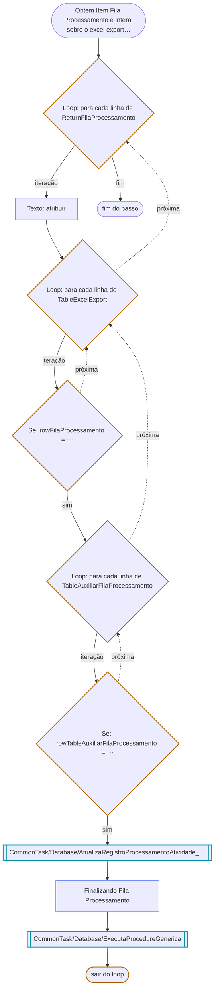

# Obtem Item Fila Processamento e intera sobre o excel exportado

Passo de [P001-ExtraiFaturas](../README.md).

---

← [Obter Dados Exportados Python Para Atualizar Fila Processamento](03-obter-dados-exportados-python-para-atualizar.md)
