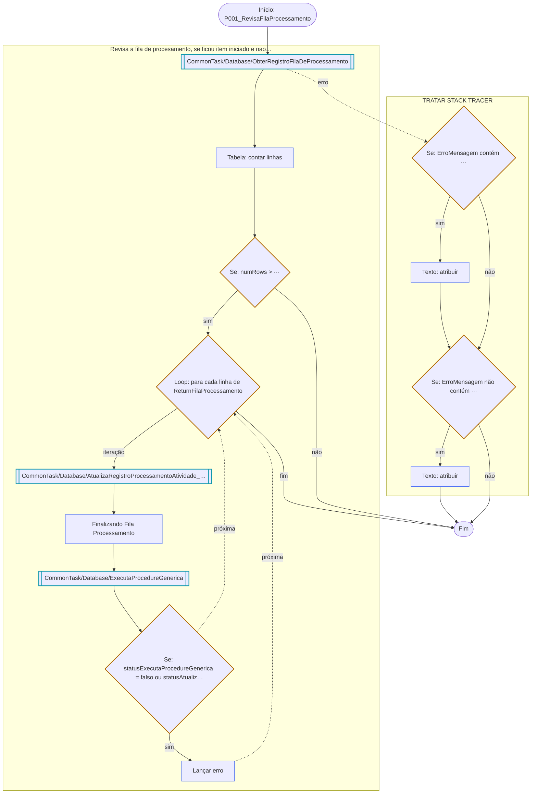

# P001_RevisaFilaProcessamento

| | |
|---|---|
| Caminho no export | `Processos/Sustentabilidade/P001-Ecobot/Tarefas/P001_RevisaFilaProcessamento` |
| Ações | 5 |
| Profundidade de expansão | 3 |

## Variáveis

| Nome | Tipo | Entrada | Saída |
|---|---|---|---|
| `SampleNumber` | Number | — | — |
| `SampleString` | String | — | — |
| `ErroMensagem` | String | — | — |
| `ErroLinha` | Number | — | — |
| `Query` | String | — | — |
| `InputsTask` | String | — | — |
| `ReturnPadhy` | Dictionary | sim | — |
| `ValuesInsertFilaProcessamento` | String | — | — |
| `IdUser` | String | sim | — |
| `ReturnFilaProcessamento` | Table | sim | — |
| `rowFilaProcessamento` | Record | — | — |
| `EncontrouRegistros` | Boolean | — | — |
| `TableAuxiliarFilaProcessamento` | Table | sim | — |
| `rowTableAuxiliarFilaProcessamento` | Record | — | — |
| `statusAtualizarAtividade` | Boolean | — | — |
| `numRows` | Number | — | — |
| `statusExecutaProcedureGenerica` | Boolean | — | — |
| `MensagemOutput` | String | — | — |
| `TableExport` | Table | — | — |
| `IdStatusExecucao` | String | sim | — |
| `DescricaoErro` | String | sim | — |

## Chamadas

Nome e tipo dos parâmetros. O valor passado não aparece: numa entrada ele é uma expressão que pode carregar literal (§9).

| Bot | Direção | Parâmetro | Tipo | Variável no chamador |
|---|---|---|---|---|
| `CommonTask/Database/ObterRegistroFilaDeProcessamento` | entrada | `ProcedureNome` | String | `ReturnPadhy` |
|  | entrada | `DiretorioTemp` | String | `ReturnPadhy` |
|  | saída | `EncontrouRegistros` | Boolean | `EncontrouRegistros` |
|  | saída | `Return` | Table | `ReturnFilaProcessamento` |
| `CommonTask/Database/AtualizaRegistroProcessamentoAtividade_v2` | entrada | `IdRegistroAtividadeFilaProcessamento` | String | `rowFilaProcessamento` |
|  | entrada | `IdStatusExecucaoAtividade` | String | ⋯ |
|  | entrada | `AtividadeStatusMensagem` | String | ⋯ |
|  | saída | `statusAtualizarAtividade` | Boolean | `statusAtualizarAtividade` |
| `CommonTask/Database/ExecutaProcedureGenerica` | entrada | `NomeProcedure` | String | `ReturnPadhy` |
|  | entrada | `ParamentrosProcedure` | String | `ValuesInsertFilaProcessamento` |
|  | saída | `statusExecutaProcedureGenerica` | Boolean | `statusExecutaProcedureGenerica` |
|  | saída | `MensagemOutput` | String | `MensagemOutput` |
|  | saída | `TableExport` | Table | `TableExport` |

## Dependências

Bots chamados:

- `CommonTask/Database/ObterRegistroFilaDeProcessamento`
- `CommonTask/Database/AtualizaRegistroProcessamentoAtividade_v2`
- `CommonTask/Database/ExecutaProcedureGenerica`

Pacotes usados: `Boolean`, `Comment`, `DataTable`, `ErrorHandler`, `If`, `Loop`, `Number`, `Step`, `String`, `System`, `TaskBot`
