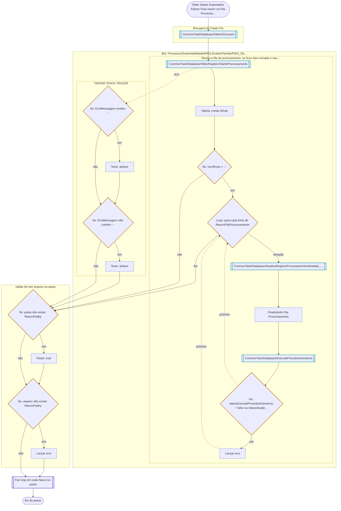

# Obter Dados Exportados Python Para Inserir na Fila Processamento

Passo de [P001-ExtraiFaturas](../P001-ExtraiFaturas.md).

---

[Faz loop em cada fatura na pasta](02-faz-loop-em-cada-fatura-na-pasta.md) →
