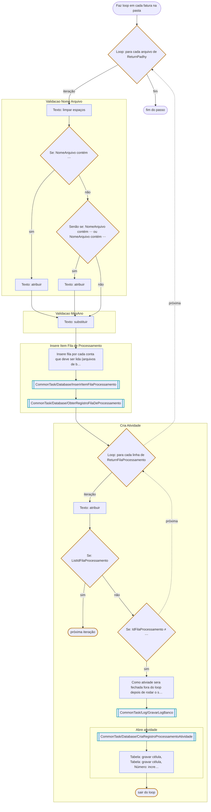

# Faz loop em cada fatura na pasta

Passo de [P001-ExtraiFaturas](../P001-ExtraiFaturas.md).

---

← [Obter Dados Exportados Python Para Inserir na Fila Processamento](01-obter-dados-exportados-python-para-inserir-na.md) · [Obter Dados Exportados Python Para Atualizar Fila Processamento](03-obter-dados-exportados-python-para-atualizar.md) →
