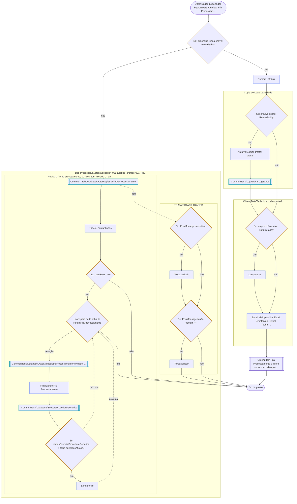

# Obter Dados Exportados Python Para Atualizar Fila Processamento

Passo de [P001-ExtraiFaturas](../P001-ExtraiFaturas.md).

---

← [Faz loop em cada fatura na pasta](02-faz-loop-em-cada-fatura-na-pasta.md) · [Obtem Item Fila Processamento e intera sobre o excel exportado](04-obtem-item-fila-processamento-e-intera-sobre-o.md) →
