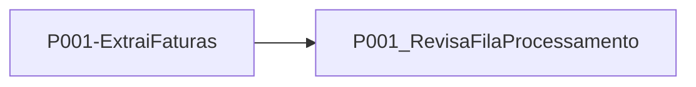

# Diagramas dos bots

2 bot(s) no export.

Outros 8 bot(s) casam com os padrões de biblioteca (`CommonTask/**`): aparecem mencionados nos fluxos de quem os chama, com os parâmetros na tabela de Chamadas de cada página, mas não têm diagrama próprio.

## Grafo de chamadas

## Inventário

| Bot | Ações | Chama | Diagrama |
|---|---|---|---|
| `Processos/Sustentabilidade/P001-Ecobot/P001-ExtraiFaturas` | 34 | 9 | [abrir](bots/Processos/Sustentabilidade/P001-Ecobot/P001-ExtraiFaturas.md) |
| `Processos/Sustentabilidade/P001-Ecobot/Tarefas/P001_RevisaFilaProcessamento` | 5 | 3 | [abrir](bots/Processos/Sustentabilidade/P001-Ecobot/Tarefas/P001_RevisaFilaProcessamento.md) |

## Pendências

- 2 arquivo(s) do export ignorado(s) por não serem bots.
