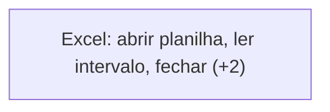
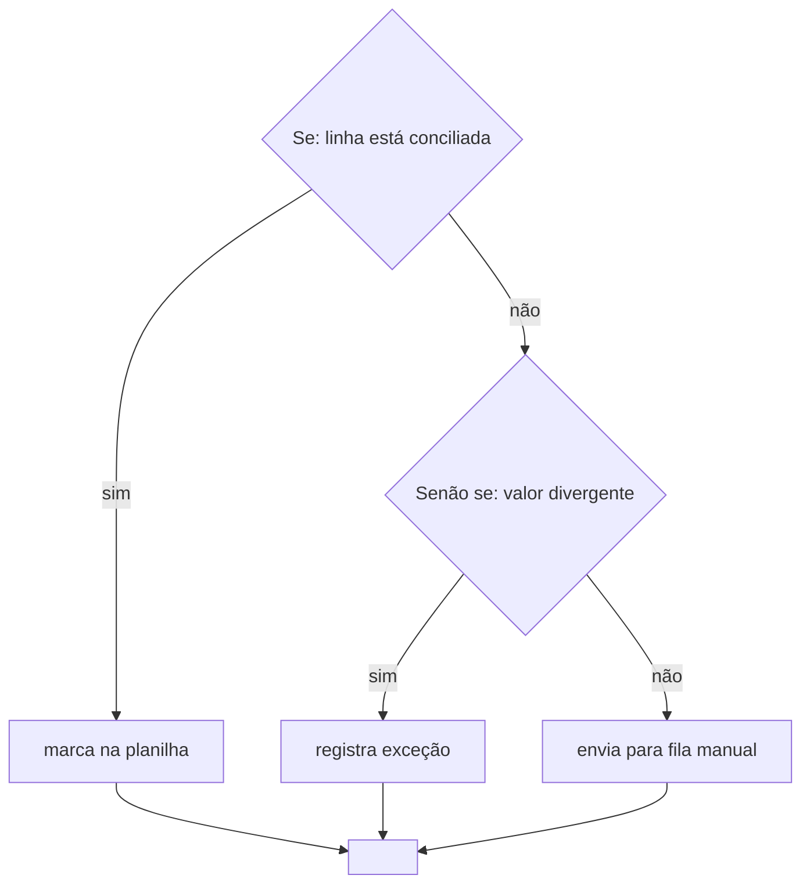
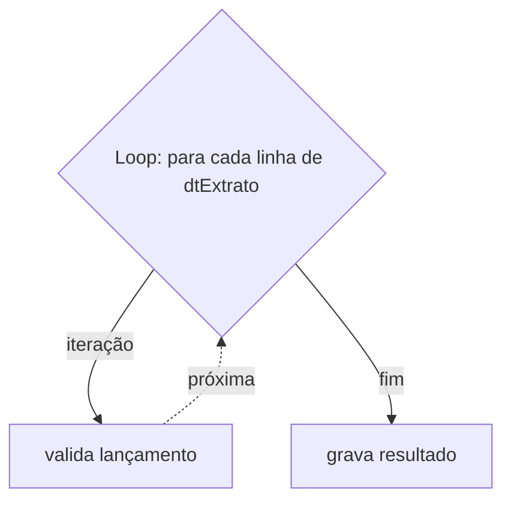
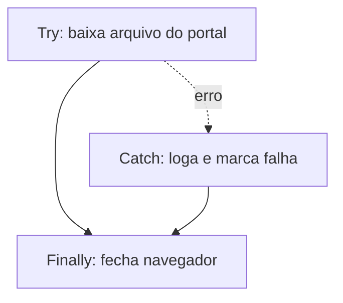

# Spec — Conversor de export Automation Anywhere A360 para diagramas Mermaid

| | |
|---|---|
| Projeto | `aa-diagram-export` |
| Versão desta spec | 0.4 (MVP parcial) |
| Data | 2026-11-04 |
| Status | Pipeline implementado e testado, menos o `parser.py`. As premissas da §11 seguem pendentes de validação contra um export real. |

---

## 1. Objetivo

Ler um export de bots do Automation Anywhere **A360** e gerar documentação navegável em Markdown, com o fluxo de cada bot desenhado em Mermaid e um diagrama geral de dependências entre bots.

O alvo é a documentação viver no git ao lado do código dos bots: texto, diffável, renderizando direto no GitHub/GitLab sem ferramenta externa.

## 2. Escopo

Dentro:

- Task Bots do A360 (arquivos `.json` do export).
- Fluxo interno de cada bot, no nível da estrutura de controle.
- Grafo de chamadas entre bots.
- Expansão inline de subtarefas (`Run Task`).

Fora do MVP (ver §13 para a lista completa): Form bots, API tasks, bots da v11 (`.atmx`), saída em DrawIO, renderização para imagem.

## 3. Entrada

O script aceita **`.zip` do Control Room ou pasta já extraída**, detectando qual dos dois recebeu pelo caminho passado. Sendo `.zip`, extrai para um diretório temporário descartado no fim.

Dentro da entrada, o script varre recursivamente os arquivos de bot e preserva a estrutura de pastas do export, porque é ela que dá o caminho lógico do bot (`Bots/Financeiro/ConciliacaoDiaria`) usado para resolver as chamadas de `Run Task`.

Arquivos que não sejam bots são ignorados em silêncio, mas contados no relatório.

## 4. Saída

Um diretório de saída com:

```
<out>/
  index.md                  grafo de chamadas, inventário e pendências
  bots/
    Financeiro/
      ConciliacaoDiaria.md  um arquivo por bot
```

Cada `bots/**/<bot>.md` traz:

1. Cabeçalho: nome, caminho no export, contagem de ações, profundidade de expansão aplicada.
2. Diagrama do fluxo em bloco ` ```mermaid `.
3. Tabela de variáveis (nome, tipo, entrada/saída).
4. Lista de bots chamados e de pacotes usados.

O `index.md` traz o grafo de chamadas (`flowchart LR`, um nó por bot, uma aresta por chamada), uma tabela-inventário de todos os bots e uma seção de pendências: bots referenciados e não encontrados, ciclos detectados, arquivos ignorados.

## 5. Decisões de desenho fechadas

| Decisão | Escolha |
|---|---|
| Escopo do diagrama | Fluxo interno por bot **e** grafo de chamadas entre bots |
| Granularidade | Só estrutura de controle; sequências lineares de ações colapsam em um nó resumido |
| Subtarefas (`Run Task`) | Expandidas **inline** no diagrama do chamador |
| Proteção da expansão | Profundidade máxima 3 (flag `--max-depth`); ciclo vira nó de recursão sem expandir |
| Bot chamado ausente | Nó marcado como não resolvido, processamento segue, pendência vai pro relatório |
| Rótulos | Nome do passo escrito pelo dev; na falta, nome do comando. **Nenhum valor literal** |
| Formato de saída | `.md` com bloco ` ```mermaid ` |
| Entrada | `.zip` ou pasta, detectado automaticamente |
| Idioma | Código em inglês; docs, comentários e `dicionario.toml` em português |
| Configuração | `dicionario.toml` na raiz, único arquivo que o time edita |
| Execução | Linha de comando; `.bat` clicável e CI ficam fora do MVP |
| Dependências | Execução: nenhuma por ora, cada nova com razão registrada. Desenvolvimento: `pytest`, `ruff` |

## 6. Arquitetura

Três camadas, propositalmente desacopladas, porque a descrição do projeto admite DrawIO como alternativa ao Mermaid e porque o formato do A360 muda entre versões.

```
export (.zip|dir) → [loader]   → inventário de bots
                  → [parser]   → model (modelo intermediário)
                  → [resolver] → model com subtarefas expandidas
                  → [render]   → .md com Mermaid
```

O **model** é a única coisa que o render conhece. Um render DrawIO futuro consome o mesmo model sem tocar no parser; um parser para a v11 produz o mesmo model sem tocar no render.

### 6.1 Critério de simplicidade

O time que mantém isso não é profundamente técnico. O que trava um time nessa situação não é quantidade de arquivos nem recurso de linguagem — é **indireção**: quando entender uma coisa exige pular por cinco lugares.

Por isso o critério aqui não é lista de proibição, é uma pergunta: *alguém júnior do time acha sozinho onde mexer e entende o efeito da mudança?* O que passa nesse teste entra — polimorfismo e dependência externa inclusos.

Os padrões abaixo são escolhas de partida, cada uma com a razão e a condição de abrir exceção.

**Travessia do fluxo com `match`, não com método por tipo de nó.** A razão é a assimetria deste projeto: os tipos de nó são fechados, vêm da linguagem do A360 e não vão crescer, enquanto as operações sobre eles vão (Mermaid agora, DrawIO depois, talvez métricas e validação). Com `match`, operação nova é arquivo novo; com método por tipo, operação nova obriga a encostar em todas as classes. Se a assimetria fosse a inversa — tipos crescendo, operação única — método seria a escolha certa.

**Método no model é bem-vindo para o que é intrínseco ao nó**: `node_id()`, `label()`, `is_control_flow()`. A resposta é a mesma para qualquer renderer, então mora junto do dado. A única linha que não se cruza é método que produz saída de um renderer específico, tipo `to_mermaid()` — aí o model passa a conhecer o Mermaid e a porta do DrawIO fecha.

**Dependência: o que importa é separar execução de desenvolvimento**, porque o risco é bem diferente nos dois casos.

- *Desenvolvimento* (`pytest`, `ruff`): sem restrição. Quem só roda o script nunca as instala, então não tocam a máquina de ninguém do time.
- *Execução*: o filtro não é "externa ou não", é **pura ou compilada**. Biblioteca Python pura instala em qualquer lugar. Compilada pode não ter wheel pronta para o 3.14 no Windows, e aí a instalação vira problema justamente para quem não é técnico — então entra só depois de confirmar que a wheel existe. Cada dependência de execução fica registrada na tabela abaixo com a razão de estar lá.

| Dependência de execução | Razão | Status |
|---|---|---|
| — | — | nenhuma até agora |

Candidatas consideradas e dispensadas por ora: `jinja2` (f-string resolve os templates do MVP), `click`/`typer` (`argparse` resolve), `networkx` (detectar ciclo é uma DFS de ~15 linhas).

### 6.2 Modelo intermediário

```python
Bot(path, name, variables, packages, body: tuple[Node, ...])

# Node é union de (todos carregam `uid`, de onde sai o id estável do diagrama):
ActionBlock(commands, label)              # sequência linear colapsada
If(branches, else_body)                   # Branch(condition, body)
Loop(kind, expression, body)              # kind: for_each | n_times | while
TryCatch(try_body, catch_body, finally_body)
Step(title, body)                         # agrupador do A360
CallBot(target_path, state, body)         # state: expanded | unresolved | cycle
                                          #        | depth_limit | dynamic_target
Break() / Continue()
```

As dataclasses são imutáveis: o resolver reconstrói a árvore em vez de mutá-la,
o que torna impossível uma etapa corromper a entrada de outra.

A travessia, tanto no resolver quanto no render, tem esta forma:

```python
def render(node: Node) -> str:
    match node:
        case ActionBlock(): ...
        case If(branches=branches, else_body=else_body): ...
        case Loop(kind=kind, expression=expression, body=body): ...
        ...
```

Os métodos que moram no modelo são só os intrínsecos ao nó — `node_id` e
`is_control_flow` —, nunca os que produzem saída de um renderer (§6.1).

### 6.3 Idioma

Código em inglês — nomes de arquivo, função, classe e variável — seguindo a convenção do ecossistema Python. Comentários, mensagens de erro, README, esta spec e o `dicionario.toml` em português. O time lê em português exatamente a parte que precisa editar.

### 6.4 O painel de ajustes

A decisão que mais importa para este cenário não é de módulo: é **separar o que o time vai querer mexer do que ninguém abre**.

Na prática, os pedidos de ajuste serão: o rótulo amigável de um comando do A360, as cores do diagrama, a profundidade padrão e quais comandos contam como estrutura de controle. Tudo isso vive num único `dicionario.toml` na raiz (§10.2). Nenhum desses ajustes exige abrir um `.py`.

`tomllib` é biblioteca padrão desde o 3.11, então a configuração em TOML não custa dependência nenhuma, e um erro de edição produz mensagem clara em vez de quebrar o programa — ao contrário de configuração escrita em Python.

## 7. Mapeamento para Mermaid

Direção `flowchart TD` nos bots, `flowchart LR` no grafo de chamadas.

### Legenda de formas

| Forma | Significado |
|---|---|
| `([...])` estádio | Início e fim do bot |
| `[...]` retângulo | Bloco de ações lineares |
| `{...}` rombo | Decisão: cabeçalho de `If` ou de `Loop` |
| `[[...]]` subrotina | Chamada de bot não expandida (ciclo ou limite de profundidade) |
| `[/.../]` paralelogramo | Bot referenciado e não encontrado no export |
| `subgraph` | `Step` do A360 e bot expandido inline |
| aresta sólida | Fluxo normal |
| aresta pontilhada | Caminho de exceção e retorno de iteração |

### Construções

**Bloco de ações lineares.** Um nó só, rotulado com o label do dev se houver; na falta, com os nomes dos comandos, no máximo 3 e com `(+N)` no resto:



**If / Else If / Else.** Um rombo por condição, encadeados; arestas rotuladas:



**Loop.** Cabeçalho em rombo, corpo em fluxo normal, retorno de iteração em aresta pontilhada, saída rotulada:



Sem `subgraph` nos loops: a combinação de `subgraph` com aresta de retorno sai desalinhada no Mermaid. `subgraph` fica reservado para `Step` e para bot expandido, que são agrupamentos sem aresta de retorno.

**Try / Catch / Finally.** Caminho de erro em aresta pontilhada, convergindo no `Finally`:



**Step.** `subgraph` com o título do step.

**Bot expandido inline.** `subgraph` rotulado com o caminho do bot chamado, contendo o fluxo dele; a aresta de entrada chega no primeiro nó interno e a de saída parte do último.

**Bot não expandido.** Nó `[["⟲ recursão: Bots/X (não expandido)"]]` para ciclo, `[["⇣ profundidade 3 atingida: Bots/X"]]` para limite, `[/"Bots/X — não encontrado no export"/]` para ausente.

### Estilo

`classDef` por categoria (controle, ações, chamada, não resolvido, erro), usando **contorno colorido e preenchimento neutro** em vez de preenchimento forte, para o diagrama continuar legível nos temas claro e escuro do GitHub — preenchimento escuro com texto escuro é o modo mais comum de um diagrama Mermaid ficar ilegível em um dos dois temas.

### IDs de nó

ID = `n` + 8 primeiros caracteres do hash do `uid` da ação no A360. Dessa forma, inserir uma ação no começo do bot não renumera o diagrama inteiro, e o diff no git fica restrito ao que mudou de fato. Sem `uid` disponível, cai para hash do caminho na árvore.

### Escape de rótulo

Rótulo sempre entre aspas duplas. `"` vira `#quot;`, quebra de linha vira `<br/>`, e os caracteres que o Mermaid interpreta (`[ ] { } ( ) | # ;`) são escapados ou removidos. Truncagem em 60 caracteres com `…`.

## 8. Expansão de subtarefas

Ao encontrar um `Run Task`:

1. Resolve o caminho do bot chamado contra o inventário do export. Caminho vem de parâmetro do comando e pode ser relativo ou absoluto no repositório do Control Room — a normalização é um dos pontos a validar (§11).
2. Não encontrado → nó não resolvido, pendência registrada, segue.
3. Já presente na cadeia de chamadas atual → nó de ciclo, não expande.
4. Profundidade atual ≥ `--max-depth` (padrão 3) → nó de limite, não expande.
5. Caso contrário → expande o corpo dentro de um `subgraph`.

O caminho dinâmico (`Run Task` cujo alvo vem de variável) não é resolvível estaticamente: vira nó não resolvido com nota de que o alvo é dinâmico.

A expansão inline não impede o bot chamado de ter também o seu próprio `.md`: todo bot do export ganha um arquivo, chamado por alguém ou não.

## 9. Rótulos e dado sensível

Nenhum valor literal de parâmetro entra no diagrama. A regra é estrutural, não heurística: o renderer só tem acesso a nomes de passo, nomes de comando e nomes de variável, nunca ao valor configurado. Isso elimina a classe inteira de vazamento de senha, token, URL interna e caminho de rede para dentro de um arquivo versionado, sem depender de acertar uma lista de campos sensíveis.

Condições de `If` e expressões de `Loop` aparecem **por nome de variável**: `Se: valor divergente` ou `Loop: para cada linha de dtExtrato`, não `Se: valor > 10000`.

Comentários (`Comment`) do A360 são absorvidos como rótulo do bloco de ações seguinte, quando esse bloco não tiver label próprio.

## 10. Execução, configuração e layout

### 10.1 CLI

Python 3.14, a versão do venv do repo. O MVP roda só com biblioteca padrão (`zipfile`, `json`, `argparse`, `pathlib`, `hashlib`, `dataclasses`, `tomllib`); a política de dependências está na §6.1.

O time roda por linha de comando:

```
python -m aa_diagram_export --input <zip|dir> --out <dir>
                            [--max-depth N]        # padrão vem do dicionario.toml
                            [--no-call-graph]
                            [--fail-on-missing]    # sai != 0 se houver bot não resolvido
                            [--quiet]
```

Um `.bat` clicável na raiz e uma GitHub Action que regenera os diagramas a cada export novo foram considerados e ficaram fora do MVP. Ambos são casca em volta desta mesma CLI, então entram depois sem mudar nada do que está aqui.

O que precisa continuar simples é a instalação na máquina de quem só gera diagramas. Por isso dependência de execução passa pelo filtro da §6.1, enquanto `pytest` e `ruff` ficam em `requirements-dev.txt` e nunca alcançam esse caminho.

### 10.2 dicionario.toml

Único arquivo que o time edita. Fica na raiz do repositório.

```toml
[geral]
profundidade_maxima = 3

[estilo]
# contorno colorido com preenchimento neutro: legível nos temas claro e escuro
controle       = "stroke:#b26a00"
acoes          = "stroke:#4c6ef5"
chamada        = "stroke:#2f9e44"
nao_resolvido  = "stroke:#e03131,stroke-dasharray:4 3"

[comandos_amigaveis]
# "Pacote:Comando" do A360 = rótulo que aparece no diagrama
"Excel advanced:Open"             = "Excel: abrir planilha"
"Excel advanced:GetMultipleCells" = "Excel: ler intervalo"
"Browser:Launch"                  = "Navegador: abrir"

[estruturas_de_controle]
# pacotes tratados como estrutura; o resto colapsa em bloco linear
pacotes = ["If", "Loop", "ErrorHandler", "Step", "TaskBot"]
```

Comando sem entrada em `comandos_amigaveis` cai para o nome cru do A360 e é listado no relatório do `index.md`, para o time ir preenchendo o dicionário conforme aparecem.

### 10.3 Layout

```
pyproject.toml          metadados, e a configuração do pytest e do ruff
dicionario.toml         o painel de ajustes do time
requirements-dev.txt    pytest e ruff: só quem desenvolve instala
src/aa_diagram_export/
  __main__.py   CLI: chama as etapas na ordem do pipeline
  config.py     lê o dicionario.toml
  model.py      as dataclasses do fluxo
  paths.py      como um caminho de bot é escrito e comparado
  loader.py     zip/pasta → inventário de arquivos de bot
  parser.py     JSON do A360 → model
  resolver.py   expande os Run Task, trata ciclo e profundidade
  render.py     model → Mermaid e Markdown
tests/
  conftest.py            o mecanismo de snapshot e a flag --regenerar
  example_model.py       bots de exemplo montados à mão
  test_render.py
  test_resolver.py
  test_paths_config.py
  fixtures/
    esperado/            os .md e .mmd que o render deve produzir
    export_exemplo/      a criar, quando o .zip chegar
docs/
  spec.md
```

`paths.py` mora sozinho de propósito. Ele é a única costura dependente do
formato do export que não está dentro do parser: quando as premissas 7 e 10 da
§11 forem confirmadas, a correção entra lá e nenhuma outra camada muda.

### 10.4 Testes

Snapshot com `pytest`: o teste roda o pipeline sobre `fixtures/export_exemplo/` e compara byte a byte com `fixtures/esperado/`. Mudou o resultado, o teste quebra e o diff aponta a linha do diagrama que mudou.

`pytest` em vez de `unittest` porque é dependência de desenvolvimento — quem só gera diagramas não instala nada — e o ganho é concreto: diff legível na falha de comparação e `parametrize` para rodar o mesmo teste sobre cada bot do fixture sem repetir código.

Uma flag `--regenerar` reescreve os esperados, para quando a mudança no diagrama for intencional. É o formato de teste que alguém pouco técnico consegue ler e corrigir, e já cobre o critério de saída byte-idêntica da §12.

## 11. Premissas a validar contra um export real — **bloqueador do MVP**

Esta spec foi escrita sem um export em mãos. O desenho acima não depende do formato, mas o `parser.py` depende inteiramente dele. Pontos a confirmar antes de implementar:

1. Layout do `.zip`: onde ficam os arquivos de bot, qual a extensão, o que mais vem no pacote (pacotes, dependências, metadados).
2. Como distinguir Task Bot de Form bot e de API task dentro do export.
3. O campo que guarda a árvore de ações e o nome do campo de filhos.
4. Como `If`/`Else If`/`Else` guardam os ramos e a condição.
5. Como `Loop` guarda o tipo de iteração e a coleção iterada.
6. Como `Try`/`Catch`/`Finally` delimitam os blocos.
7. `package`/`command` do `Run Task` e em que parâmetro fica o caminho do bot chamado, e em que forma (relativo, absoluto, com ou sem extensão).
8. Onde fica o label/descrição que o dev digita numa ação.
9. Onde fica a lista de variáveis, com tipo e marcação de entrada/saída.
10. Se o export preserva nome de pasta e nome de bot de forma consistente com o caminho que o `Run Task` referencia.

**O que preciso:** um export `.zip` do Control Room com pelo menos um bot que use `If`, `Loop`, `Try/Catch` e `Run Task` chamando outro bot do mesmo export. Pode ser anonimizado. Com ele, viram fixture de teste em `tests/fixtures/`.

## 12. Critérios de aceite do MVP

1. `python -m aa_diagram_export --input export.zip --out docs/bots` roda e termina em 0.
2. Gera um `.md` por Task Bot do export, com diagrama Mermaid sintaticamente válido (validado por `mmdc` ou pelo parser do Mermaid em CI).
3. `If`, `Loop`, `Try/Catch`, `Step` e `Run Task` aparecem corretamente no diagrama de um bot de referência.
4. `Run Task` para bot do export aparece expandido; para bot de fora, aparece como não resolvido e listado no `index.md`.
5. Ciclo entre dois bots não causa recursão infinita.
6. Nenhum valor literal de parâmetro aparece em qualquer `.md` gerado.
7. Rodar duas vezes sobre o mesmo export produz saída byte-idêntica.

## 13. Fora de escopo do MVP

Saída DrawIO (o IR já prevê), bots da v11 (`.atmx`), Form bots, API tasks, Process/Co-pilot, renderização para SVG/PNG, métricas de complexidade, detecção de ação inalcançável, diff entre duas versões de um bot, diagrama de sequência, integração direta com a API do Control Room.
