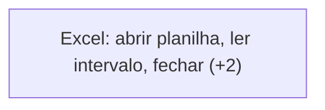
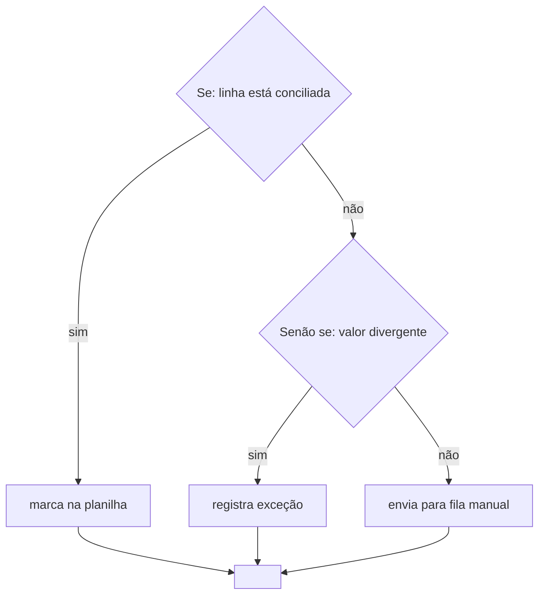
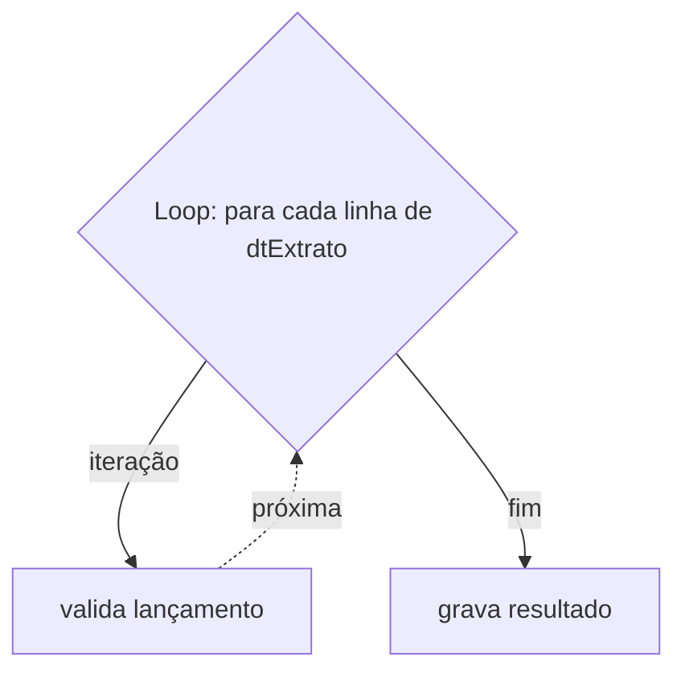
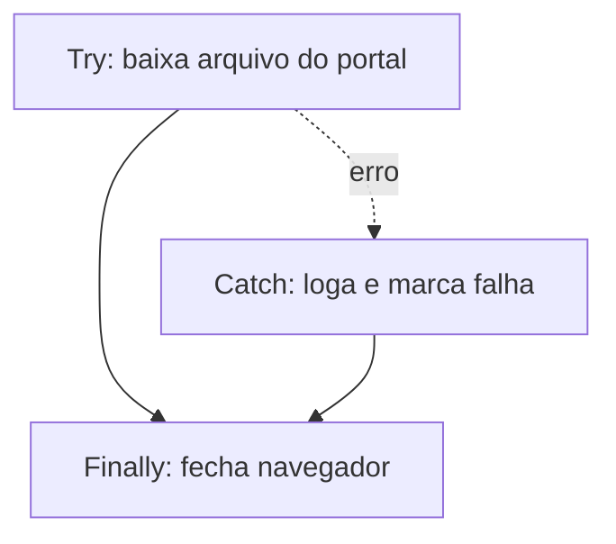

# Spec — Conversor de export Automation Anywhere A360 para diagramas Mermaid

| | |
|---|---|
| Projeto | `aa-diagram-export` |
| Versão desta spec | 0.7 (MVP completo) |
| Data | 2026-11-09 |
| Status | Pipeline completo, validado contra um export real. O formato do A360 está documentado na §11. |

---

## 1. Objetivo

Ler um export de bots do Automation Anywhere **A360** e gerar documentação navegável em Markdown, com o fluxo de cada bot desenhado em Mermaid e um diagrama geral de dependências entre bots.

O alvo é a documentação viver no git ao lado do código dos bots: texto, diffável, renderizando direto no GitHub/GitLab sem ferramenta externa.

## 2. Escopo

Dentro:

- Task Bots do A360 (arquivos `.json` do export).
- Fluxo interno de cada bot, no nível da estrutura de controle.
- Grafo de chamadas entre bots.
- Expansão inline de subtarefas (`Run Task`).

Fora do MVP (ver §13 para a lista completa): Form bots, API tasks, bots da v11 (`.atmx`), saída em DrawIO, renderização para imagem.

## 3. Entrada

O script aceita **`.zip` do Control Room ou pasta já extraída**, detectando qual dos dois recebeu pelo caminho passado. Sendo `.zip`, extrai para um diretório temporário descartado no fim.

Dentro da entrada, o script varre recursivamente os arquivos de bot e preserva a estrutura de pastas do export, porque é ela que dá o caminho lógico do bot (`Bots/Financeiro/ConciliacaoDiaria`) usado para resolver as chamadas de `Run Task`.

Arquivos que não sejam bots são ignorados em silêncio, mas contados no relatório.

## 4. Saída

Um diretório de saída com:

```
<out>/
  index.md                  grafo de chamadas, inventário e pendências
  bots/
    Financeiro/
      ConciliacaoDiaria.md  um arquivo por bot
      ConciliacaoDiaria/    os passos detalhados, quando o bot é grande (§8.2)
```

Cada `bots/**/<bot>.md` traz:

1. Cabeçalho: nome, caminho no export, contagem de ações, profundidade de expansão aplicada.
2. Diagrama do fluxo em bloco ` ```mermaid `.
3. Tabela de variáveis (nome, tipo, entrada/saída).
4. Lista de bots chamados e de pacotes usados.

O `index.md` traz o grafo de chamadas (`flowchart LR`, um nó por bot, uma aresta por chamada), uma tabela-inventário de todos os bots e uma seção de pendências: bots referenciados e não encontrados, ciclos detectados, arquivos ignorados.

## 5. Decisões de desenho fechadas

| Decisão | Escolha |
|---|---|
| Escopo do diagrama | Fluxo interno por bot **e** grafo de chamadas entre bots |
| Granularidade | Só estrutura de controle; sequências lineares de ações colapsam em um nó resumido |
| Subtarefas (`Run Task`) | Expandidas **inline** no diagrama do chamador |
| Proteção da expansão | Profundidade máxima 3 (flag `--max-depth`); ciclo vira nó de recursão sem expandir |
| Bot chamado ausente | Nó marcado como não resolvido, processamento segue, pendência vai pro relatório |
| Rótulos | Nome do passo escrito pelo dev; na falta, nome do comando. **Nenhum valor literal** |
| Formato de saída | `.md` com bloco ` ```mermaid ` |
| Entrada | `.zip` ou pasta, detectado automaticamente |
| Idioma | Código em inglês; docs, comentários e `dicionario.toml` em português |
| Configuração | `dicionario.toml` na raiz, único arquivo que o time edita |
| Execução | Linha de comando; `.bat` clicável e CI ficam fora do MVP |
| Dependências | Execução: nenhuma por ora, cada nova com razão registrada. Desenvolvimento: `pytest`, `ruff` |
| Bibliotecas | Padrões em `dicionario.toml`; o bot é mencionado no fluxo de quem chama, sem página própria (§8.3) |
| Orçamento de nós | Diagrama acima de 30 nós quebra em arquivos de passo numa pasta irmã (§8.2) |
| Orçamento de arestas | Diagrama acima de 480 arestas é refeito com um nível a menos de expansão (§8.1) |

## 6. Arquitetura

Três camadas, propositalmente desacopladas, porque a descrição do projeto admite DrawIO como alternativa ao Mermaid e porque o formato do A360 muda entre versões.

```
export (.zip|dir) → [loader]   → inventário de bots
                  → [parser]   → model (modelo intermediário)
                  → [resolver] → model com subtarefas expandidas
                  → [render]   → .md com Mermaid
```

O **model** é a única coisa que o render conhece. Um render DrawIO futuro consome o mesmo model sem tocar no parser; um parser para a v11 produz o mesmo model sem tocar no render.

### 6.1 Critério de simplicidade

O time que mantém isso não é profundamente técnico. O que trava um time nessa situação não é quantidade de arquivos nem recurso de linguagem — é **indireção**: quando entender uma coisa exige pular por cinco lugares.

Por isso o critério aqui não é lista de proibição, é uma pergunta: *alguém júnior do time acha sozinho onde mexer e entende o efeito da mudança?* O que passa nesse teste entra — polimorfismo e dependência externa inclusos.

Os padrões abaixo são escolhas de partida, cada uma com a razão e a condição de abrir exceção.

**Travessia do fluxo com `match`, não com método por tipo de nó.** A razão é a assimetria deste projeto: os tipos de nó são fechados, vêm da linguagem do A360 e não vão crescer, enquanto as operações sobre eles vão (Mermaid agora, DrawIO depois, talvez métricas e validação). Com `match`, operação nova é arquivo novo; com método por tipo, operação nova obriga a encostar em todas as classes. Se a assimetria fosse a inversa — tipos crescendo, operação única — método seria a escolha certa.

**Método no model é bem-vindo para o que é intrínseco ao nó**: `node_id()`, `label()`, `is_control_flow()`. A resposta é a mesma para qualquer renderer, então mora junto do dado. A única linha que não se cruza é método que produz saída de um renderer específico, tipo `to_mermaid()` — aí o model passa a conhecer o Mermaid e a porta do DrawIO fecha.

**Dependência: o que importa é separar execução de desenvolvimento**, porque o risco é bem diferente nos dois casos.

- *Desenvolvimento* (`pytest`, `ruff`): sem restrição. Quem só roda o script nunca as instala, então não tocam a máquina de ninguém do time.
- *Execução*: o filtro não é "externa ou não", é **pura ou compilada**. Biblioteca Python pura instala em qualquer lugar. Compilada pode não ter wheel pronta para o 3.14 no Windows, e aí a instalação vira problema justamente para quem não é técnico — então entra só depois de confirmar que a wheel existe. Cada dependência de execução fica registrada na tabela abaixo com a razão de estar lá.

| Dependência de execução | Razão | Status |
|---|---|---|
| — | — | nenhuma até agora |

Candidatas consideradas e dispensadas por ora: `jinja2` (f-string resolve os templates do MVP), `click`/`typer` (`argparse` resolve), `networkx` (detectar ciclo é uma DFS de ~15 linhas).

### 6.2 Modelo intermediário

```python
Bot(path, name, variables, packages, body: tuple[Node, ...])

# Node é union de (todos carregam `uid`, de onde sai o id estável do diagrama):
ActionBlock(commands, label)              # sequência linear colapsada
If(branches, else_body)                   # Branch(condition, body)
Loop(kind, expression, body)              # kind: for_each | n_times | while
TryCatch(try_body, catch_body, finally_body)
Step(title, body)                         # agrupador do A360
CallBot(target_path, state, body)         # state: expanded | unresolved | cycle
                                          #        | depth_limit | dynamic_target
Break() / Continue()
```

As dataclasses são imutáveis: o resolver reconstrói a árvore em vez de mutá-la,
o que torna impossível uma etapa corromper a entrada de outra.

A travessia, tanto no resolver quanto no render, tem esta forma:

```python
def render(node: Node) -> str:
    match node:
        case ActionBlock(): ...
        case If(branches=branches, else_body=else_body): ...
        case Loop(kind=kind, expression=expression, body=body): ...
        ...
```

Os métodos que moram no modelo são só os intrínsecos ao nó — `node_id` e
`is_control_flow` —, nunca os que produzem saída de um renderer (§6.1).

### 6.3 Idioma

Código em inglês — nomes de arquivo, função, classe e variável — seguindo a convenção do ecossistema Python. Comentários, mensagens de erro, README, esta spec e o `dicionario.toml` em português. O time lê em português exatamente a parte que precisa editar.

### 6.4 O painel de ajustes

A decisão que mais importa para este cenário não é de módulo: é **separar o que o time vai querer mexer do que ninguém abre**.

Na prática, os pedidos de ajuste serão: o rótulo amigável de um comando do A360, as cores do diagrama, a profundidade padrão e quais comandos contam como estrutura de controle. Tudo isso vive num único `dicionario.toml` na raiz (§10.2). Nenhum desses ajustes exige abrir um `.py`.

`tomllib` é biblioteca padrão desde o 3.11, então a configuração em TOML não custa dependência nenhuma, e um erro de edição produz mensagem clara em vez de quebrar o programa — ao contrário de configuração escrita em Python.

## 7. Mapeamento para Mermaid

Direção `flowchart TD` nos bots, `flowchart LR` no grafo de chamadas.

### Legenda de formas

| Forma | Significado |
|---|---|
| `([...])` estádio | Início e fim do bot |
| `[...]` retângulo | Bloco de ações lineares |
| `{...}` rombo | Decisão: cabeçalho de `If` ou de `Loop` |
| `[[...]]` subrotina | Chamada de bot não expandida (ciclo ou limite de profundidade) |
| `[/.../]` paralelogramo | Bot referenciado e não encontrado no export |
| `subgraph` | `Step` do A360 e bot expandido inline |
| aresta sólida | Fluxo normal |
| aresta pontilhada | Caminho de exceção e retorno de iteração |

### Construções

**Bloco de ações lineares.** Um nó só, rotulado com o label do dev se houver; na falta, com os nomes dos comandos, no máximo 3 e com `(+N)` no resto:



**If / Else If / Else.** Um rombo por condição, encadeados; arestas rotuladas:



**Loop.** Cabeçalho em rombo, corpo em fluxo normal, retorno de iteração em aresta pontilhada, saída rotulada:



Sem `subgraph` nos loops: a combinação de `subgraph` com aresta de retorno sai desalinhada no Mermaid. `subgraph` fica reservado para `Step` e para bot expandido, que são agrupamentos sem aresta de retorno.

**Try / Catch / Finally.** Caminho de erro em aresta pontilhada, convergindo no `Finally`:



**Step.** `subgraph` com o título do step.

**Bot expandido inline.** `subgraph` rotulado com o caminho do bot chamado, contendo o fluxo dele; a aresta de entrada chega no primeiro nó interno e a de saída parte do último.

**Bot não expandido.** Nó `[["⟲ recursão: Bots/X (não expandido)"]]` para ciclo, `[["⇣ profundidade 3 atingida: Bots/X"]]` para limite, `[/"Bots/X — não encontrado no export"/]` para ausente.

### Estilo

`classDef` por categoria (controle, ações, chamada, não resolvido, erro), usando **contorno colorido e preenchimento neutro** em vez de preenchimento forte, para o diagrama continuar legível nos temas claro e escuro do GitHub — preenchimento escuro com texto escuro é o modo mais comum de um diagrama Mermaid ficar ilegível em um dos dois temas.

### IDs de nó

ID = `n` + 8 primeiros caracteres do hash do `uid` da ação no A360. Dessa forma, inserir uma ação no começo do bot não renumera o diagrama inteiro, e o diff no git fica restrito ao que mudou de fato. Sem `uid` disponível, cai para hash do caminho na árvore.

### Escape de rótulo

Rótulo sempre entre aspas duplas. `"` vira `#quot;`, quebra de linha vira `<br/>`, e os caracteres que o Mermaid interpreta (`[ ] { } ( ) | # ;`) são escapados ou removidos. Truncagem em 60 caracteres com `…`.

## 8. Expansão de subtarefas

Ao encontrar um `Run Task`, na ordem:

1. Alvo dinâmico (vem de variável, com `$` no caminho) → nó não resolvido com nota de alvo dinâmico. Não dá pra resolver estaticamente.
2. Alvo casa com um padrão de `bibliotecas` → nó de biblioteca, mencionado e não expandido (§8.3). Vem antes de "não encontrado" de propósito: utilitário que ficou de fora do export é biblioteca mesmo assim, não erro.
3. Alvo já presente na cadeia de chamadas atual → nó de ciclo, não expande.
4. Não encontrado no inventário → nó não resolvido, pendência registrada, segue.
5. Profundidade já aplicada ≥ `--max-depth` → nó de limite, não expande.
6. Caso contrário → expande o corpo dentro de um `subgraph`.

A comparação de caminhos é o ponto delicado, porque o export escreve o mesmo bot de duas formas (§11.2). Ela mora inteira em `paths.normalize`.

### 8.1 Orçamento de arestas

**O Mermaid recusa diagrama com mais de 500 arestas.** `maxEdges` é configuração segura, que não pode ser elevada de dentro do arquivo, e o GitHub renderiza com o padrão. Passar de 500 não degrada o diagrama: ele simplesmente não aparece.

Isso não é hipotético. No primeiro export real processado, o bot orquestrador do processo dava 592 arestas em profundidade 2, contra 376 em profundidade 1 e 76 sem expansão nenhuma.

Por isso o gerador trata profundidade como teto, não como ordem: desenha, conta as arestas e, passando de 480, refaz com um nível a menos até caber. A página do bot diz até onde expandiu e por quê, e o `index.md` lista os bots reduzidos.

Um bot que sozinho passe do limite, já sem expansão, sai mesmo assim, com um aviso na página de que pode não renderizar. Entregar o diagrama com aviso é melhor que não entregar.

### 8.2 Quebra em arquivos

Arestas são o limite do Mermaid. Legibilidade é outro, bem mais baixo, e não tem nada a ver com o renderizador: o navegador encaixa o SVG na largura da coluna — cerca de 870 px no GitHub — e escala o desenho inteiro junto. Altura não incomoda, a página rola. Largura, sim: um diagrama que nasce com 3000 px chega a 29% do tamanho, e a fonte de 16 px vira 4,6 px.

Disso vem uma consequência contraintuitiva que vale registrar, porque é a primeira ideia que ocorre: **aumentar a fonte não resolve**. Letra maior deixa cada caixa maior, o desenho fica mais largo e o navegador reduz mais. Dá na mesma.

O que funciona é reduzir o conteúdo por desenho. Passando de `orcamento_de_nos` (padrão 30), os `Step` maiores saem do diagrama principal e viram **arquivos próprios**, numa pasta irmã com o nome do bot:

```
bots/Processos/Sustentabilidade/P001-Ecobot/
  P001-ExtraiFaturas.md                        panorama e metadados
  P001-ExtraiFaturas/
    01-obter-dados-exportados-python-para-inserir.md
    02-faz-loop-em-cada-fatura-na-pasta.md
```

Arquivo separado em vez de âncora na mesma página porque o link vira um caminho de verdade: navega melhor, aparece na árvore do repositório e cada passo abre sozinho.

O `Step` é a costura natural: é o agrupador que o próprio dev criou no A360, tem título, e tirar um da vista não altera o fluxo, só esconde o miolo.

A escolha é gulosa — tira o maior `Step` ainda desenhado por inteiro, redesenha, repete até caber. Três detalhes que importam:

- Só entram os `Step` mais rasos de cada ramo. Tirar um que está dentro de outro que continua no desenho deixaria um arquivo fora do caminho de leitura.
- `Step` com menos de 4 nós não é candidato: a navegação ganharia um salto para economizar quase nada.
- Seção que continua passando do orçamento é quebrada de novo. Bot sem `Step` nenhum não tem onde cortar e sai inteiro.

**A numeração segue a ordem de leitura, não a de extração.** Como a extração é gulosa, ela sai por tamanho: numerar por ela daria `01` ao maior passo e não ao primeiro, o contrário do que alguém espera ao percorrer a pasta. Por isso o trabalho sai em três fases — decidir quais saem, ordenar pelo fluxo e nomear, e só então desenhar com os links definitivos, já que o nome de cada arquivo depende da ordem final de todos.

O nome vem do título, sem acento e sem maiúscula, cortado numa fronteira de palavra. Quem garante unicidade é o número, então dois `Step` com o mesmo título não colidem.

Medido no export real, no bot orquestrador:

| | Nós |
|---|---|
| antes, com tudo expandido | 263 |
| só com as bibliotecas mencionadas | 76 |
| panorama, depois da quebra | 30 |
| os quatro arquivos de passo | 21, 22, 24 e 12 |

**A navegação é por link Markdown, não por clique no nó.** O `securityLevel` padrão do Mermaid é `strict`, que desativa `click`, e é configuração segura: como o `maxEdges`, não pode ser mudada de dentro do diagrama, e o GitHub usa o padrão. Então a página do bot lista os passos numa tabela com link, e cada arquivo de passo traz link de volta ao bot e para o passo anterior e o seguinte. O `click` é emitido junto, apontando para o arquivo, como bônus para quem abrir fora do GitHub.

A quebra é só apresentação: o modelo não sabe que arquivo de passo existe. O render recebe um mapa de "este `Step` vira referência, apontando para tal caminho" e o resto segue igual, o que mantém a porta do DrawIO aberta.

### 8.3 Bibliotecas

Bot que casa com um padrão de `[geral] bibliotecas` é utilitário compartilhado, não um passo do processo. Ele aparece **mencionado** no fluxo de quem chama, com forma e cor próprias, mas não é expandido, não ganha página e fica fora do grafo de chamadas e do inventário. Os parâmetros dele continuam registrados na tabela de Chamadas de cada chamador (§9.1).

No export real, 8 dos 10 bots eram utilitários de `CommonTask`: sem isso, o índice e os diagramas dos processos ficavam dominados por infraestrutura.

O padrão vive no `dicionario.toml` e não no código porque cada repositório tem a sua convenção de pastas. Bibliotecas continuam sendo lidas e entram no inventário interno — é dali que sai o tipo declarado de cada parâmetro, e é isso que impede um utilitário de ser confundido com bot ausente.

A expansão inline não impede o bot chamado de ter o seu próprio `.md`: todo bot do export que não seja biblioteca ganha um arquivo, chamado por alguém ou não.

## 9. Rótulos e dado sensível

Nenhum valor literal de parâmetro entra no diagrama. A regra é estrutural, não heurística: o renderer só tem acesso a nomes de passo, nomes de comando e nomes de variável, nunca ao valor configurado. Isso elimina a classe inteira de vazamento de senha, token, URL interna e caminho de rede para dentro de um arquivo versionado, sem depender de acertar uma lista de campos sensíveis.

Condições de `If` e expressões de `Loop` aparecem **por nome de variável**: `Se: valor divergente` ou `Loop: para cada linha de dtExtrato`, não `Se: valor > 10000`.

Comentários (`Comment`) do A360 são absorvidos como rótulo do bloco de ações seguinte, quando esse bloco não tiver label próprio.


### 9.1 A tabela de Chamadas

Cada página lista, numa tabela, o que o bot troca com cada bot chamado: nome do parâmetro, tipo, direção e a variável do chamador ligada a ele.

O valor passado nunca entra. Numa entrada ele é uma expressão que pode carregar literal — `$ReturnPadhy{"BancoDeDados.ObterFila"}$`, por exemplo —, então só o nome da variável é extraído dela. Quando a entrada é um literal puro, a coluna mostra `⋯`.

O tipo vem das variáveis declaradas no bot chamado, não do ponto de chamada, porque numa saída o tipo no ponto de chamada é sempre `VARIABLE`.

A tabela importa mais para as bibliotecas: como elas não têm página própria (§8.3), ela é o único registro de que parâmetros cada utilitário recebe e devolve.

No modelo isso é `CallBinding`, com os campos `name`, `type`, `is_output` e `bound_to`. O nome é "ligação" e não "argumento" de propósito: aqui não existe argumento no sentido de valor. O campo chamava-se `args` numa primeira versão e a guarda de teste da §9 recusou — corretamente, porque o nome sugeria o que o campo não pode carregar.

## 10. Execução, configuração e layout

### 10.1 CLI

Python 3.14, a versão do venv do repo. O MVP roda só com biblioteca padrão (`zipfile`, `json`, `argparse`, `pathlib`, `hashlib`, `dataclasses`, `tomllib`); a política de dependências está na §6.1.

O time roda por linha de comando:

```
python -m aa_diagram_export --input <zip|dir> --out <dir>
                            [--max-depth N]        # padrão vem do dicionario.toml
                            [--no-call-graph]
                            [--fail-on-missing]    # sai != 0 se houver bot não resolvido
                            [--quiet]
```

Um `.bat` clicável na raiz e uma GitHub Action que regenera os diagramas a cada export novo foram considerados e ficaram fora do MVP. Ambos são casca em volta desta mesma CLI, então entram depois sem mudar nada do que está aqui.

O que precisa continuar simples é a instalação na máquina de quem só gera diagramas. Por isso dependência de execução passa pelo filtro da §6.1, enquanto `pytest` e `ruff` ficam em `requirements-dev.txt` e nunca alcançam esse caminho.

### 10.2 dicionario.toml

Único arquivo que o time edita. Fica na raiz do repositório.

```toml
[geral]
profundidade_maxima = 3
orcamento_de_nos = 30
bibliotecas = ["CommonTask/**"]

[estilo]
# contorno colorido com preenchimento neutro: legível nos temas claro e escuro
controle      = "stroke:#b26a00,stroke-width:2px"
acoes         = "stroke:#4c6ef5,stroke-width:1px"
biblioteca    = "stroke:#1098ad,stroke-width:2px"
secao         = "stroke:#5f3dc4,stroke-width:2px"
nao_resolvido = "stroke:#e03131,stroke-width:2px,stroke-dasharray:4 3"

[comandos_amigaveis]
# "Pacote:Comando" do A360 = rótulo que aparece no diagrama
"Database:connect"       = "Banco: conectar"
"Excel:OpenSpreadsheet"  = "Excel: abrir planilha"
```

Comando sem entrada em `comandos_amigaveis` cai para o nome cru do A360 e é listado nas pendências do `index.md`. O arquivo versionado já vem com os comandos do primeiro export processado.

Comando dentro de um bloco que o dev nomeou não entra nessa lista: o rótulo do dev substitui os nomes de comando, então não há nada de feio a corrigir ali.

**Não existe opção para "o que conta como estrutura de controle".** `If`, `Loop`, `Try` e `Step` são o que são na linguagem do A360 e o parser os reconhece pelo `commandName`. Uma chave que não mudasse nada seria pior que chave nenhuma, principalmente para um time que vai confiar no que está escrito no arquivo.

### 10.3 Layout

```
pyproject.toml          metadados, e a configuração do pytest e do ruff
dicionario.toml         o painel de ajustes do time
requirements-dev.txt    pytest e ruff: só quem desenvolve instala
src/aa_diagram_export/
  __main__.py   CLI: chama as etapas na ordem do pipeline
  config.py     lê o dicionario.toml
  model.py      as dataclasses do fluxo
  paths.py      como um caminho de bot é escrito e comparado
  loader.py     zip/pasta → inventário de arquivos de bot
  parser.py     JSON do A360 → model
  resolver.py   expande os Run Task, trata ciclo e profundidade
  render.py     model → Mermaid e Markdown
  layout.py     quebra um bot grande em seções
tests/
  conftest.py            o mecanismo de snapshot e a flag --regenerar
  example_model.py       bots de exemplo montados à mão
  test_render.py
  test_resolver.py
  test_paths_config.py    caminhos, dicionário e loader
  test_parser.py          JSON do A360 → modelo
  test_cli.py             pipeline ponta a ponta, bibliotecas e arestas
  test_layout.py          quebra em seções
  fixtures/
    esperado/            os .md e .mmd que o render deve produzir
docs/
  spec.md
```

`paths.py` mora sozinho de propósito. Ele é a única costura dependente do
formato do export que não está dentro do parser. É ele que faz as duas formas de
caminho da §11.2 casarem; errar ali transforma todo Run Task em "bot não
encontrado".

### 10.4 Testes

Snapshot com `pytest`: o teste roda o pipeline sobre `fixtures/export_exemplo/` e compara byte a byte com `fixtures/esperado/`. Mudou o resultado, o teste quebra e o diff aponta a linha do diagrama que mudou.

`pytest` em vez de `unittest` porque é dependência de desenvolvimento — quem só gera diagramas não instala nada — e o ganho é concreto: diff legível na falha de comparação e `parametrize` para rodar o mesmo teste sobre cada bot do fixture sem repetir código.

Uma flag `--regenerar` reescreve os esperados, para quando a mudança no diagrama for intencional. É o formato de teste que alguém pouco técnico consegue ler e corrigir, e já cobre o critério de saída byte-idêntica da §12.

## 11. O formato do export do A360

Validado em 2026-11-05 contra um export real do Control Room: 195 MB, 45 arquivos, 10 Task Bots, 370 nós.

### 11.1 O pacote

Quase tudo num export é **pacote**, não bot: 33 `.jar` respondiam por 190 dos 195 MB. O loader nunca os lê para a memória.

Os bots são arquivos **sem extensão nenhuma**, sob `Automation Anywhere\Bots\...`. Quem é bot vem do `manifest.json`, pela `contentType`:

```json
{"path": "Automation Anywhere\\Bots\\CommonTask\\Log\\GravarLogBanco",
 "contentType": "application/vnd.aa.taskbot", "excluded": false}
```

Qualquer detecção por extensão encontraria zero bots. Sem manifest, o loader cai para reconhecimento por conteúdo: objeto JSON com a chave `nodes`.

### 11.2 As duas formas do caminho

O mesmo bot aparece escrito de dois jeitos, e eles precisam casar:

| Onde | Como |
|---|---|
| manifest e entrada do zip | `Automation Anywhere\Bots\CommonTask\Log\GravarLogBanco` |
| atributo `taskbotFile` de um `runTask` | `repository:///Automation%20Anywhere/Bots/CommonTask/Log/GravarLogBanco` |

Separador diferente, prefixo diferente e espaço percent-encoded. `paths.normalize` leva os dois a `CommonTask/Log/GravarLogBanco`. Sem isso, todo `Run Task` viraria "bot não encontrado".

### 11.3 A árvore de ações

O bot é um objeto com `triggers`, `nodes`, `variables`, `packages`, `properties`. Cada nó:

```json
{"uid": "...", "commandName": "try", "packageName": "ErrorHandler",
 "disabled": false, "attributes": [...], "children": [...], "branches": [...]}
```

- `children` é o corpo; `branches` são os ramos alternativos, e cada ramo é um nó com `commandName` próprio: `elseIf` e `else` num `if`, `catch` e `finally` num `try`.
- `disabled: true` é ação desligada no A360. Não roda, então não entra no diagrama.

Mapa de `commandName` para o modelo:

| commandName | vira |
|---|---|
| `if` + ramos `elseIf` / `else` | `If` |
| `try` + ramos `catch` / `finally` | `TryCatch` |
| `loop.commands.start` | `Loop` |
| `loop.commands.break` / `.continue` | `Break` / `Continue` |
| `step` (tem `title`) | `Step` |
| `runTask` | `CallBot` |
| `Comment` | rótulo do próximo bloco |
| qualquer outro | ação dentro de um `ActionBlock`, nomeada `Pacote:Comando` |

Comando desconhecido que tenha `children` vira agrupador, não ação, para as ações de dentro não sumirem do diagrama quando a Automation Anywhere lançar um pacote novo.

### 11.4 Não existe rótulo na ação

**O A360 não guarda um label por ação.** O que o dev escreve são nós `Comment` separados, com um atributo `comment`. É daí que sai o rótulo dos blocos: um comentário rotula o bloco de ações seguinte.

Comentário seguido direto de uma estrutura de controle é descartado — `If` e `Loop` já se explicam pela condição, e criar um nó só para o texto encheria o diagrama de caixa sem fluxo.

### 11.5 Condições

Vêm em duas formas, e confundir as duas produz `Se: ⋯` sem sentido:

**Comparação** (`numberVariable`, `stringVariable`, `booleanVariable`, `listVariable`): atributos `variable`, `operator`, `value`, encadeados por `operatorAttribute` com `operator` `OR` ou `AND`.

**Predicado** (`fileExists`, `fileNotExists`, `folderDoesNotExists`, `valueExistsForKey`): não compara nada. O sentido está no `conditionalName` e os atributos são argumentos dele.

Operadores vistos: `EQ`, `NEQ`, `GT`, `LTE`, `INCLUDE`, `NOTINCLUDE` — sem underscore em `NOTINCLUDE`.

### 11.6 Loops

`loopType` é `ITERATOR` ou `WHILE`. Sendo `ITERATOR`, o que manda é `iterator.value.iteratorName`:

| iteratorName | texto |
|---|---|
| `iteratorTableRow` | para cada linha de `<sourceTable>` |
| `loop.iterators.files` | para cada arquivo de `<folderPath>` |
| `loop.iterators.times` | repetir `<times>` vezes |

`WHILE` usa a mesma estrutura de condição do `if`.

### 11.7 Variáveis

Em `variables`, no topo do bot: `name`, `type`, `input`, `output`, `description`, `subtype`, `defaultValue`. Só os quatro primeiros entram no modelo — `defaultValue` carregaria valor literal (§9).

### 11.8 Parâmetros de um Run Task

As entradas vivem em `taskbot.value.taskbotInput.dictionary`, onde a **chave é o nome do parâmetro no bot chamado** e o valor é a expressão passada:

```json
{"key": "ProcedureNome",
 "value": {"type": "STRING", "expression": "$ReturnPadhy{\"BancoDeDados.ObterFila\"}$"}}
```

As saídas vivem em `returnTo` no próprio nó, mapeando a saída do chamado para a variável do chamador:

```json
{"key": "EncontrouRegistros",
 "value": {"type": "VARIABLE", "variableName": "EncontrouRegistros"}}
```

Não existe `taskbotOutput`. Dos 20 `runTask` do export, 9 tinham saída mapeada.

Os dois lados são nome de variável, então cabem na §9 sem exceção. O tipo real vem das variáveis declaradas no bot chamado: no ponto de chamada, a saída aparece sempre como `VARIABLE`.

## 12. Critérios de aceite do MVP

Todos verificados em 2026-11-05, contra o export real e pela suíte de 74 testes.

| | Critério | Como foi verificado |
|---|---|---|
| 1 | A CLI roda e termina em 0 | export real: 10 bots, 11 arquivos, `rc=0` |
| 2 | Um `.md` por Task Bot, com Mermaid válido | os 11 diagramas renderizados por `mmdc` |
| 3 | `If`, `Loop`, `Try/Catch`, `Step` e `Run Task` corretos | `test_parser.py`, um teste por construção |
| 4 | `Run Task` expandido; bot de fora como não resolvido | `test_resolver.py`, `test_cli.py` |
| 5 | Ciclo não causa recursão infinita | `test_resolver.py::test_ciclo_nao_recursa_infinitamente` |
| 6 | Nenhum valor literal num `.md` gerado | guarda estrutural no modelo e no parser |
| 7 | Duas rodadas dão saída byte-idêntica | `test_cli.py::test_rodar_duas_vezes_da_o_mesmo_byte` |

Um oitavo critério apareceu durante a validação e entrou junto: **nenhum diagrama gerado pode passar do limite de arestas do Mermaid** (§8.1), porque acima dele o arquivo não renderiza em lugar nenhum.

## 13. Fora de escopo do MVP

Saída DrawIO (o IR já prevê), bots da v11 (`.atmx`), Form bots, API tasks, Process/Co-pilot, renderização para SVG/PNG, métricas de complexidade, detecção de ação inalcançável, diff entre duas versões de um bot, diagrama de sequência, integração direta com a API do Control Room.
