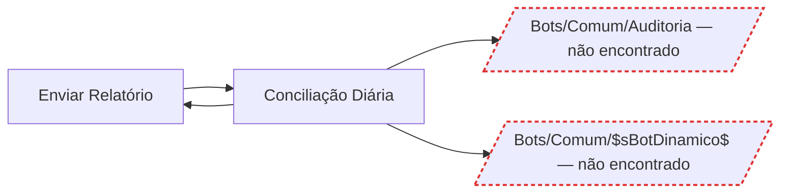

# Diagramas dos bots

2 bot(s) no export.

## Grafo de chamadas

## Inventário

| Bot | Ações | Chama | Diagrama |
|---|---|---|---|
| `Bots/Comum/EnviarRelatorio` | 1 | 1 | [abrir](EnviarRelatorio/README.md) |
| `Bots/Financeiro/ConciliacaoDiaria` | 13 | 3 | [abrir](ConciliacaoDiaria/README.md) |

## Pendências

### Bots referenciados e não encontrados no export

- `Comum/Auditoria` — chamado por `Bots/Financeiro/ConciliacaoDiaria`

### Comandos sem rótulo no dicionario.toml

Aparecem no diagrama com o nome cru do A360. Cadastrar em `[comandos_amigaveis]`:

- `"Browser:Download"`
- `"Excel advanced:SetCell"`

- 2 arquivo(s) do export ignorado(s) por não serem bots.
